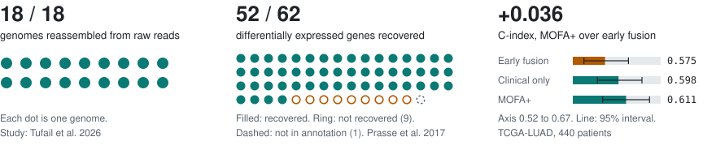

# Shabroz Khan Baloch

**Bioinformatician in London. I check a result by reproducing it.**

I take published studies back to their raw sequencing reads, run the
analysis again, and see whether the paper's numbers come back.

[Personal page](https://shabrozkhanbaloch.github.io/) ·
[LinkedIn](https://www.linkedin.com/in/shabroz-khan-baloch) ·
[ORCID](https://orcid.org/0009-0005-4812-4840)

<picture>
  <source media="(prefers-color-scheme: dark)" srcset="results-dark.svg">
  
</picture>

## Where to look

| Repository | What it is | Built with |
| :--- | :--- | :--- |
| [rnaseq_analysis](https://github.com/shabrozkhanbaloch/rnaseq_analysis) | The RNA-seq reproduction (52 / 62), from raw reads to figures | Bash, R, Docker |
| [luad-multiomics](https://github.com/shabrozkhanbaloch/luad-multiomics) | Multi-omics survival analysis with three external validation cohorts; data on [Zenodo](https://doi.org/10.5281/zenodo.24509337) | Python, R, make, pytest |
| [hybrid_genome_assembly_guide](https://github.com/shabrozkhanbaloch/hybrid_genome_assembly_guide) | Bacterial genomes from Illumina + Nanopore reads, as bash scripts or a Nextflow workflow | Bash, Nextflow |

The genome reproduction (18 / 18) and a glioma multi-omics analysis are private for now; ask me for the code.

## Background

- **MSc Bioinformatics, Distinction**, University of West London, 2026
- **BSc (Hons) Computing, First Class**, Arden University, 2024, with the Arden Achiever Prize
- **HND Computing**, New City College, 2020
- **Bioinformatics ka Chilla**, Codanics: a one-year hands-on course, 2025 to 2026

## Tools

`R` `Python` `Bash` `Nextflow` `Docker` `conda` `renv` `Make` `pytest`
`DESeq2` `READemption` `MOFA+` `DIABLO` `Unicycler` `Bakta` `CheckM2`
`BUSCO` `QUAST` `Plassembler` `ABRicate` `geNomad`

---

**Open to work** in bioinformatics or computational biology, in London or
remote. The quickest way to reach me is
[LinkedIn](https://www.linkedin.com/in/shabroz-khan-baloch).
